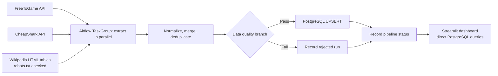

# PC Game Analytics

ลำดับที่ 27 · รหัสนิสิต 6621601255 · [GitHub Repository](https://github.com/suphats0n/02739452-27-6621601255)

ผลทดสอบระบบจริงหลังทำงานต่ออยู่ใน [reports/verification.md](reports/verification.md)

ระบบรวบรวม วิเคราะห์ และแสดงข้อมูลเกม PC ฟรีและดีลลดราคาจากแหล่งข้อมูลสาธารณะ ด้วย Apache Airflow, PostgreSQL และ Streamlit — โครงการปฏิบัติวิชา 02739452

> รายการทดสอบหรือคะแนนในเอกสารนี้จะถือว่าสำเร็จเมื่อรันและตรวจผลจริงแล้วเท่านั้น ไม่มีข้อมูลเกมตัวอย่างที่ใช้แทนผลจากแหล่งข้อมูลจริง

## แหล่งข้อมูล

| แหล่ง | ข้อมูล | วิธีดึง |
|---|---|---|
| [FreeToGame API](https://www.freetogame.com/api/games?platform=pc) | เกมฟรี ชื่อ ประเภท ผู้พัฒนา ผู้เผยแพร่ วันเปิดตัว แพลตฟอร์ม และ URL | HTTP GET; ทดลอง `platform=pc` และใช้ `windows` เป็น fallback |
| [CheapShark API](https://www.cheapshark.com/api/1.0/deals?pageSize=60) | ดีลเกม PC ราคาเต็ม/ราคาลด ส่วนลด ร้านค้า และคะแนนดีล | HTTP GET สูงสุด 3 หน้า พร้อม lookup ชื่อร้านค้า |
| [Wikipedia](https://en.wikipedia.org/wiki/List_of_free_PC_games) | ชื่อเกม ประเภท ผู้พัฒนา ผู้เผยแพร่ และข้อมูลเท่าที่ตารางมี | requests + BeautifulSoup; อ่าน robots.txt ก่อน scrape และใช้ [List of computer role-playing games](https://en.wikipedia.org/wiki/List_of_computer_role-playing_games) เป็น fallback |

ทุก request ใช้ timeout, retry/backoff และ User-Agent ระบุแอป การ scrape จะไม่ทำหาก robots.txt ไม่อนุญาต ไม่มี API key, Selenium หรือข้อมูลส่วนบุคคล ฟิลด์ที่ไม่มีข้อมูลเก็บเป็น `NULL`; ราคา CheapShark ระบุ USD และไม่สร้างราคาให้แหล่งอื่น

## Architecture



ฐานข้อมูลเกมประกอบด้วย `raw_games` (ข้อมูลรายแหล่ง), `games` (เกม normalize/deduplicate), `game_offers` (ดีลแยกตามร้าน) และ `pipeline_runs`/`pipeline_source_runs` (สถานะงาน) การรันซ้ำใช้ unique keys และ `ON CONFLICT DO UPDATE` โดยไม่สร้างเกมซ้ำ

การ deduplicate ใช้ normalized title และปีเปิดตัวเมื่อมีข้อมูล หากชื่อเดียวกันมีปีที่ทราบต่างกันจะเก็บแยก เพื่อหลีกเลี่ยงการรวมเกมคนละภาคโดยไม่ตั้งใจ

## โครงสร้างไฟล์

```text
pc-game-analytics-exam/
├── dags/pc_game_pipeline.py
├── ingestion/                 # FreeToGame, CheapShark, Wikipedia + HTTP policy
├── etl/                       # transform, quality, PostgreSQL UPSERT
├── database/init.sql
├── web/app.py                 # Thai Streamlit dashboard
├── web/Dockerfile
├── scripts/                   # live-source, database, pipeline integration checks
├── reports/README.md          # โครงรายงาน 3 หน้า พร้อมจุดแนบภาพจริง
├── docker-compose.yml
├── Dockerfile.airflow
├── requirements.txt
├── .env.example
└── README.md
```

## ข้อกำหนดก่อนเริ่ม

- Docker Desktop ทำงานอยู่ และมี Docker Compose v2
- พอร์ต `8191`, `8502`, `5453` ต้องว่าง
- Python 3.11+ สำหรับรัน integration tests ในเครื่อง (หรือใช้ Docker service)

## ติดตั้งและเปิดระบบ

จากโฟลเดอร์โปรเจกต์ใน PowerShell:

```powershell
if (-not (Test-Path .env)) { Copy-Item .env.example .env }
notepad .env
```

เปลี่ยน password ทุกตัวใน `.env` เป็นค่าของตนเอง แล้วเริ่ม containers:

```powershell
docker compose up --build -d
docker compose ps
```

ครั้งแรกอาจใช้เวลาหลายนาทีในการดาวน์โหลด Airflow image และติดตั้ง dependencies ตารางเกมถูกสร้างอัตโนมัติเมื่อ PostgreSQL เริ่มต้นฐานข้อมูลครั้งแรก

### เข้าใช้งาน

- Airflow UI: <http://localhost:8191> — ใช้ `AIRFLOW_ADMIN_USERNAME` และ `AIRFLOW_ADMIN_PASSWORD` จาก `.env`
- Dashboard: <http://localhost:8502>
- PostgreSQL เกม: `localhost:5453` จากเครื่อง host; service อื่นเชื่อมผ่าน hostname `analytics-db:5432`

### Trigger DAG

1. เปิด Airflow UI และลงชื่อเข้าใช้
2. เลือก `pc_game_analytics_pipeline`
3. เปิด DAG toggle แล้วกด **Trigger DAG**
4. ตรวจ Graph View หรือ Grid View ว่า Extract ทั้ง 3 tasks ทำงานพร้อมกัน และ `record_pipeline_status` สำเร็จ
5. เปิด Dashboard และตรวจ KPI / Pipeline Status หลัง load เสร็จ

ตารางรันประจำวันตั้งเวลา 02:00 UTC; จะไม่มี backfill ของรอบที่ผ่านมา

## ทดสอบ

ติดตั้ง dependencies ใน Python environment (แนะนำ Python 3.11):

```powershell
python -m pip install -r requirements.txt
```

ตั้ง connection variables ใน PowerShell ตาม `.env` ก่อนเรียกสคริปต์ฐานข้อมูล:

```powershell
$env:ANALYTICS_DB_HOST = "localhost"
$env:ANALYTICS_DB_PORT = "5453"
$env:ANALYTICS_DB_NAME = "game_analytics"
$env:ANALYTICS_DB_USER = "game_analytics"
$env:ANALYTICS_DB_PASSWORD = "ค่าจากไฟล์ .env"
```

ทดสอบ syntax/import:

```powershell
python -m compileall -q dags ingestion etl web scripts
```

ทดสอบ source จริง (เครือข่ายต้องเข้าถึงบริการภายนอกได้; คำสั่งนี้ต้องดึงรวมอย่างน้อย 100 records):

```powershell
python scripts/test_sources.py
```

ทดสอบ pipeline transformation, source failure tolerance และ quality accept/reject:

```powershell
python scripts/test_pipeline.py
```

ทดสอบ normalization/deduplication และ quality rules แบบ offline:

```powershell
python scripts/test_transform.py
```

ทดสอบ schema และ UPSERT ซ้ำใน PostgreSQL:

```powershell
python scripts/test_database.py
```

ทดสอบ Airflow DAG ใน container:

```powershell
docker compose exec airflow-scheduler airflow dags list-import-errors
docker compose exec airflow-scheduler airflow dags test pc_game_analytics_pipeline 2026-10-23
```

> `airflow dags test` เรียก extractor จริง และโหลดข้อมูลเข้า PostgreSQL; ห้ามใช้แทนหลักฐาน run โดยตรวจ UI ประกอบ

ทดสอบ UPSERT และ Dashboard ภายใน containers โดยใช้ connection environment ของ Compose:

```powershell
docker compose exec dashboard python scripts/test_database.py
docker compose exec dashboard python scripts/test_dashboard.py
```

ตรวจจำนวนข้อมูล:

```sql
SELECT 'games' AS table_name, COUNT(*) AS rows FROM games
UNION ALL SELECT 'raw_games', COUNT(*) FROM raw_games
UNION ALL SELECT 'game_offers', COUNT(*) FROM game_offers;

SELECT source, COUNT(*) AS raw_games
FROM raw_games GROUP BY source ORDER BY source;

SELECT run_id, status, records_extracted, records_loaded, failed_sources,
       quality_passed, started_at, finished_at
FROM pipeline_runs ORDER BY finished_at DESC LIMIT 10;
```

## รายงานและ Screenshot

โครงรายงาน 3 หน้าและช่องแนบภาพจริงอยู่ใน [`reports/README.md`](reports/README.md) และผลทดสอบอยู่ใน [`reports/verification.md`](reports/verification.md) ตั้งชื่อไฟล์ PDF เป็น `27_6621601255_summary.pdf` และบันทึกภาพ Airflow Graph/Grid กับ Dashboard จาก UI จริงก่อนส่ง

## หยุดระบบ

```powershell
docker compose down
```

เก็บข้อมูล PostgreSQL ไว้ใน Docker volumes; หากต้องการลบข้อมูลทั้งหมดโดยตั้งใจ:

```powershell
docker compose down -v
```

คำสั่ง `down -v` ลบฐานข้อมูลและประวัติ Airflow อย่างถาวร

## ข้อจำกัดและการส่ง GitHub

- จำนวนดีล/แถว Wikipedia เปลี่ยนตามเวลาที่เรียก API และหน้าเว็บ; Wikipedia อาจไม่อนุญาต URL หรือไม่มีตารางที่เข้ากัน ซึ่งจะถูกบันทึกเป็น source failure โดยไม่หยุดแหล่งอื่น
- FreeToGame อาจจำกัดคำขอหรือปรับ API; extractor ทดลอง `pc` แล้ว fallback เป็น `windows`
- CheapShark คืนดีลหลายร้านต่อเกม; ข้อเสนอแต่ละร้านถูกเก็บแยกเป็น USD ตาม API
- รายงาน PDF และ screenshots จาก UI จริงยังต้องจัดเตรียมตามข้อกำหนดส่งสอบ
- Remote `origin`: `https://github.com/suphats0n/02739452-27-6621601255.git`; หลังตรวจผลและ commit แล้วใช้ `git push -u origin main` เพื่อส่งด้วยบัญชีของตนเองก่อนกำหนดส่ง
- `.env` ถูก ignore และไม่ควร commit; ตรวจ `git status` และ secrets ก่อนเผยแพร่
